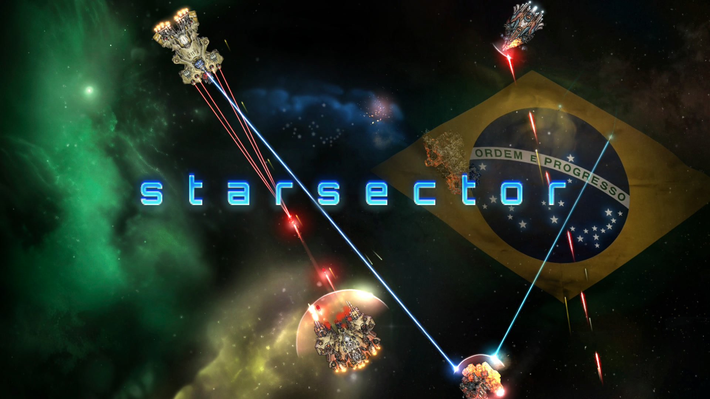
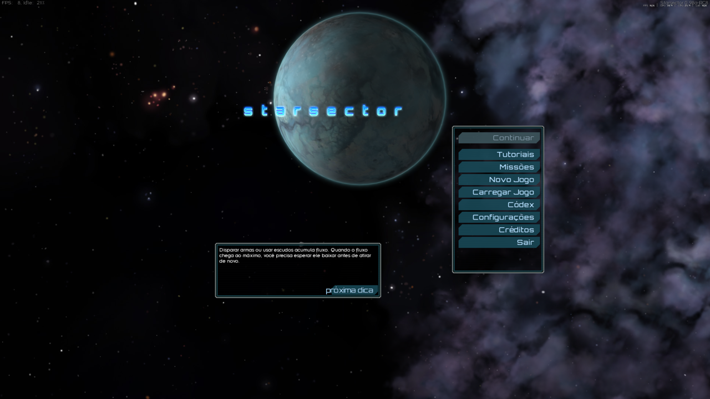

<p align="center">
  <a href="https://github.com/ArturMoreiraDeCarvalho/starsector-ptbr/releases/latest/download/PTBR_Patch.zip">
    
  </a>
</p>

<p align="center">
  Clique no banner para baixar a tradução.<br>
  Leia a seção <a href="#como-instalar-windows">Como instalar</a> antes de começar.<br>
  Se as fontes ficarem quebradas ou o instalador recusar arquivos, veja <a href="#problemas-conhecidos">Problemas conhecidos</a>.
</p>

<p align="center">
  <a href="https://github.com/ArturMoreiraDeCarvalho/starsector-ptbr/releases/latest"></a>
  <a href="https://github.com/ArturMoreiraDeCarvalho/starsector-ptbr/releases"></a>
  
  <a href="https://fractalsoftworks.com/forum/index.php?topic=36208.0"></a>
</p>

<h1 align="center">Starsector em Português do Brasil</h1>

<p align="center">
  Tradução gratuita do <b>Starsector 0.98a-RC8</b>: diálogos, missões, menus, descrições e Codex.<br>
  Com acentos em todas as fontes do jogo.
</p>

<p align="center">
  <a href="https://github.com/ArturMoreiraDeCarvalho/starsector-ptbr/releases/latest/download/PTBR_Patch.zip">
    
  </a>
</p>

---

## Novidades da v1.1.0

- **"Pontos de equipamento"**: Ordnance Points (OP) deixou de ser "pontos de artilharia", a pedido de jogadores. O termo também cobre ventiladores, capacitores e modificações.
- **Funciona melhor com outros mods**: se outro mod já alterou um arquivo do jogo, o instalador traduz as linhas que continuam iguais às do original e mantém as mudanças do mod. Antes, o arquivo ficava inteiro em inglês. O `DESINSTALAR.bat` devolve a versão do mod.
- **Acentos em oito fontes** que não tinham letras acentuadas.
- **Instalador mais seguro**: pede permissão de administrador quando a pasta do jogo é protegida, recusa outras versões do jogo sem alterar nada e mostra a versão do kit.

Já tinha a v1.0.0? **Rode o `DESINSTALAR.bat` da versão antiga antes** de instalar a nova. A lista completa está em [`MUDANCAS.txt`](kit/PTBR_Patch/MUDANCAS.txt) e nos [releases](https://github.com/ArturMoreiraDeCarvalho/starsector-ptbr/releases).

Comentários e dúvidas: [tópico no fórum do Starsector](https://fractalsoftworks.com/forum/index.php?topic=36208.0).

## Como instalar (Windows)

1. **Baixe** o [PTBR_Patch.zip](https://github.com/ArturMoreiraDeCarvalho/starsector-ptbr/releases/latest/download/PTBR_Patch.zip) (botão verde acima).
2. **Feche o jogo** e extraia o zip **dentro da pasta do Starsector**, para a pasta `PTBR_Patch` ficar ao lado de `starsector-core`:
   ```
   Starsector\
   ├── starsector-core\
   ├── PTBR_Patch\        <- aqui
   └── starsector.exe
   ```
   Pasta padrão do jogo: `C:\Program Files (x86)\Fractal Softworks\Starsector`
3. **Dê dois cliques em `PTBR_Patch\INSTALAR.bat`** e abra o jogo.

Pronto. Para **voltar ao inglês**, dê dois cliques em `PTBR_Patch\DESINSTALAR.bat`.

> **Não use o botão verde "Code > Download ZIP"** desta página: ele baixa o código do projeto, não o instalador. Use o link acima.

<p align="center">
  
</p>

## Dúvidas comuns

| Problema | Solução |
|---|---|
| O Windows pede permissão de administrador | Normal quando o jogo está em Arquivos de Programas. Clique em **Sim**. |
| Aparece "acesso negado" | Clique com o botão direito em `INSTALAR.bat` e escolha **Executar como administrador**. |
| O instalador não acha o jogo | Ele abre uma janela para você escolher a pasta do Starsector. |
| "Este kit é para o Starsector 0.98a-RC8" | Seu jogo é de outra versão. Nada foi alterado. |
| Arquivos "traduzidos em parte" | Outro mod já alterou esses arquivos. O instalador traduziu as linhas iguais às do original e manteve as mudanças do mod. Os textos que o mod trocou continuam em inglês. |
| Alguns arquivos "não foram trocados" | Nenhuma linha pôde ser traduzida (por exemplo, um jar alterado por outro patch). Restaure os originais e rode de novo. |
| Não apague a pasta `PTBR_Patch\backup_original` | É lá que ficam os arquivos originais do jogo. |
| Vou atualizar de uma versão antiga do kit | Rode o `DESINSTALAR.bat` da versão antiga, depois extraia e instale a nova. Sem isso, o instalador novo trata a tradução antiga como se fosse outro mod. |

**Linux / macOS:** com Python 3, rode dentro da pasta `PTBR_Patch`:
`python3 -X utf8 _swapLangFile.py pt` (aplica) ou `... en` (volta ao inglês). Não testado.

## O que foi traduzido

- 23.049 textos: diálogos e eventos da campanha, missões, descrições de naves, armas, sistemas, planetas e itens, menus, dicas, habilidades e o Codex.
- Textos de interface que ficam dentro do código do jogo (`starfarer_obf.jar` e `starfarer.api.jar`).
- Letras acentuadas nas oito fontes do jogo que não as tinham.
- **Continuam em inglês, por decisão:** nomes de naves e armas, e linhas de depuração do desenvolvedor.

## Problemas conhecidos

- Funciona só no **Starsector 0.98a-RC8**.
- A tradução foi feita com apoio de IA e ainda não passou por revisão completa.
- Textos de mods não são traduzidos; a compatibilidade com mods não foi testada.
- Os acentos das oito fontes foram montados com sinais que já existem na própria fonte, então podem destoar um pouco da letra.
- **Fontes quebradas com o VRAM Optimizer (causa não confirmada):** se as letras ficarem embaralhadas com esse mod ativo, o cache de texturas dele pode estar guardando a versão antiga das fontes. Para testar, desative o VRAM Optimizer, ou rode o `DDSCreator.exe` dele com **Purge Metadata** e depois **ProcessMods**, e avise o resultado.
- **Arquivos alterados por outro mod:** ficam traduzidos em parte. Veja a tabela de dúvidas comuns acima.
- As mudanças de cada versão estão em [`kit/PTBR_Patch/MUDANCAS.txt`](kit/PTBR_Patch/MUDANCAS.txt).

## Encontrou um erro?

Abra uma [Issue](https://github.com/ArturMoreiraDeCarvalho/starsector-ptbr/issues) ou comente no [tópico do fórum](https://fractalsoftworks.com/forum/index.php?topic=36208.0), com o texto em inglês, o texto em português e onde ele aparece no jogo. Se um texto aparecer cortado na tela, mande um print.

<details>
<summary><b>Para quem quer contribuir com a tradução</b></summary>

| Pasta / arquivo | Conteúdo |
|---|---|
| `kit/PTBR_Patch/` | instalador, script Python e arquivos traduzidos (dados, jars e fontes) |
| `units/` | textos originais (`.en.json`) e traduções (`.pt.json`), em blocos |
| `tools/sstr.py` | extrai os textos do jogo, valida as traduções e gera o build |
| `tools/fontfix.py` | adiciona letras acentuadas às fontes bitmap do jogo |
| `tools/glossario.py` | lista textos que fogem dos termos do `GLOSSARIO.txt` |
| `tools/textos_longos.py` | lista rótulos curtos que ficaram bem maiores em português e podem cortar na tela |
| `kit/packaging/` | monta o zip (`make_kit.py`) e testa o instalador (`teste_kit.py`) |
| `kit/PTBR_Patch/mescla.dat` | linha original → linha traduzida, usado para traduzir em parte os arquivos que outro mod alterou (gerado pelo `make_kit.py`) |
| `relatorios/textos_longos.txt` | rótulos que podem cortar na tela, para conferir no jogo |
| `COMO_ATUALIZAR.txt` | passo a passo para gerar o kit de uma versão nova do jogo |

Depois de editar uma tradução em `units/NNNN_<tipo>.pt.json`, rode:

```
python -X utf8 tools/sstr.py validate
python -X utf8 tools/glossario.py
```

Para gerar o build, o `sstr.py` precisa dos arquivos originais do jogo e do mapa de campos do projeto chinês (`ref/para_tranz_map.json`), que não estão aqui.
</details>

## Créditos

- **TruthOriginem** e colaboradores do [Starsector-Localization-CN](https://github.com/TruthOriginem/Starsector-Localization-CN): mapa de textos traduzíveis e modelo do kit.
- **jar-string-decoupler 1.0.1**, usado para separar os textos dos jars.
- **Fractal Softworks**, pelo jogo. Starsector é marca da Fractal Softworks; esta tradução não é oficial.
